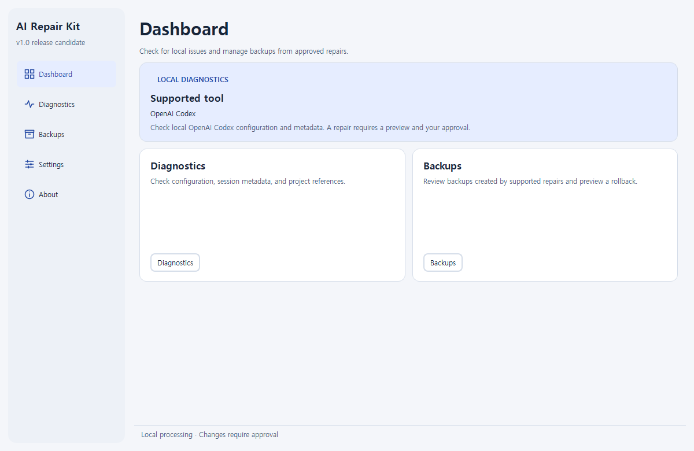

# AI Repair Kit — Codex Desktop missing projects and chats on Windows

Did Codex Desktop show **No projects**, lose its project sidebar after an update, or stop showing older chats under their projects? AI Repair Kit is an independent Windows tool that checks local project registrations, chat links, and SQLite metadata to help explain what is missing.

**[Download AI Repair Kit v1.0.0rc3 for Windows x64](https://github.com/CGI07/ai-repair-kit/releases/download/v1.0.0rc3/AI-Repair-Kit-1.0.0rc3-windows-x64.zip)** · [Release notes](https://github.com/CGI07/ai-repair-kit/releases/tag/v1.0.0rc3) · [SHA-256 checksums](https://github.com/CGI07/ai-repair-kit/releases/download/v1.0.0rc3/SHA256SUMS.txt)

1. Verify the ZIP checksum, use **Extract All**, and run **AI-Repair-Kit.exe** with **_internal** beside it. Python is included. See the [Windows installation guide](docs/windows-quick-start.md) for the Microsoft runtime and unsigned EXE.
2. Open **Diagnostics**, select the affected local Codex profile, and run a read-only scan. If a supported repair appears, close Codex and review the proposed change and backup before approving it.

**Recovery limits.** This prerelease can repair specific Desktop cache entries on four documented MSIX builds when original records agree. Other builds are diagnosis-only for Desktop cache issues. Missing chat contents and Goal records can be investigated but cannot be restored by this tool. Repairs have been tested with synthetic data. Recovery in the actual Codex Desktop interface remains unverified. [Supported versions and repair conditions](docs/desktop-recovery.md)



## What you can do

| Symptom | What AI Repair Kit can do |
| --- | --- |
| Projects disappeared from the Desktop sidebar | Check the local project catalog. Preview an empty-registry repair for MSIX `26.911.7940.0` when the surviving catalog provides the required IDs and roots. |
| Projects exist in the cache but are hidden after a custom migration | For MSIX `26.903.8094.0`, preview filling only missing numeric project timestamps from matching SQLite records. |
| Old chats no longer appear under their projects | Use a trusted pre-incident cache snapshot to restore exact associations for MSIX `26.1013.3656.0`, or for the documented empty-cache and incomplete-migration case on `26.1029.7803.0`. |
| A chat opens with only part of its history | Check the thread, referenced session file and, for known paginated storage, the history index file. [Interpret the results](docs/desktop-recovery.md#a-chat-opens-with-only-part-of-its-history). |
| A chat or Goal appears missing | Check the selected thread's recorded project link, referenced rollout file, and legacy or separate Goal records. This check does not restore chat contents or Goals. |
| The local user configuration contains only NUL bytes | Preview replacing that exact file with an empty TOML file so Codex can use defaults for the user layer. |

The version-specific repairs change only the Desktop JSON cache. A matching project directory alone is insufficient evidence of chat membership. Database changes, session reconstruction, account issues and other AI tools are outside this prerelease's recovery scope. The [recovery guide](docs/desktop-recovery.md) lists the checks, evidence, and conditions for each rule.

The application has been tested on Windows 10 x64 and an offline Windows 11 x64 guest. The tests cover synthetic profiles, including metadata created by the official bundled Codex App Server. Results from independent public incident reports and the lab's own results are recorded separately. [Windows VM verification](docs/desktop-vm-verification.md)

The [issue #42739 review](docs/issue-42739.md) records the 81 comments checked for this prerelease. It separates the common Desktop catalog mismatch from different profile, account and data failures. Each recovery rule applies only to its documented evidence and version. The [research roadmap](docs/research-roadmap.md) records related reports, evidence gaps and development priorities.

The [security and build verification notes](SECURITY.md) describe what the application reads, what it can write after approval, and how to check the download or build it from source. MSIX `26.915.4065.0`, `26.924.2738.0`, and `26.1103.4239.0` are diagnostic-only in rc3. For `26.1103.4239.0`, the lab verified that two synthetic projects and their chats stayed visible after an offline restart. Desktop recovery after applying a repair remains unverified on these builds.

### Why can the sidebar say “No projects” when the files are still there?

A local project can still have records in `state_5.sqlite` while the Desktop `local-projects` registry is empty or incomplete. Chats can still appear in Recents even if their project grouping is missing. A read-only scan can distinguish these conditions from a missing profile or database. The symptoms alone do not establish that records were deleted or that the same repair applies. [Codex issue #42739](https://github.com/openai/codex/issues/42739) · [Case analysis](docs/issue-42739.md)

## Run on Windows

The intended platform is Windows 10 1809 or later or Windows 11, x64, with 64-bit Python 3.11 for source runs. [Qt platform requirements](https://doc.qt.io/qt-6.11/windows.html)

The Windows ZIP includes Python. If needed, install the [Microsoft Visual C++ v14 Redistributable for x64](https://learn.microsoft.com/en-us/cpp/windows/latest-supported-vc-redist#latest-supported-redistributable-version).

To run from source, use these PowerShell commands from a checkout. Reuse an existing healthy Python 3.11 virtual environment.

```powershell
py -0p
py -3.11 -m venv .venv
.\.venv\Scripts\python.exe -m pip install -e .
.\.venv\Scripts\python.exe -m ai_repair_kit
```

To build a local unsigned EXE, see the [packaging procedure](CONTRIBUTING.md#build-the-windows-candidate) and the [distribution checklist](docs/distribution.md).

The interface starts in English. Choose English, Korean, or the Windows language in **Settings**. Language changes apply immediately and your selection is saved for the next launch.

## Data safety

Select a local Codex data folder and choose **Run diagnostics**. Scans read bounded metadata. The product does not open conversation transcripts or credentials and does not send data or collect telemetry. Opening the GitHub link from **About** opens your browser.

Close Codex and related background processes before recovery. Review the preview and approve each change. The program verifies a backup before writing and checks the result afterward. Rollback has its own preview and refuses to overwrite a file that no longer matches the expected state. Recovery backups may contain private configuration or cache metadata. Keep them local. [User guide](docs/user-guide.md)

## Contribute

Use [GitHub Issues](https://github.com/CGI07/ai-repair-kit/issues) for reproducible bugs and feature requests. Share synthetic fixtures or redacted summaries. Report vulnerabilities privately as described in [SECURITY.md](SECURITY.md).

See [CONTRIBUTING.md](CONTRIBUTING.md) for setup, tests, and translations, and [the architecture guide](docs/architecture.md) for recovery invariants. Near-term work focuses on independently verifying Desktop visibility after repair, expanding verified version coverage, and checking redistribution materials for a Windows package.

AI Repair Kit is an independent project licensed under [GPL-3.0-only](LICENSE). [Third-party components and distribution checklist](docs/distribution.md)
