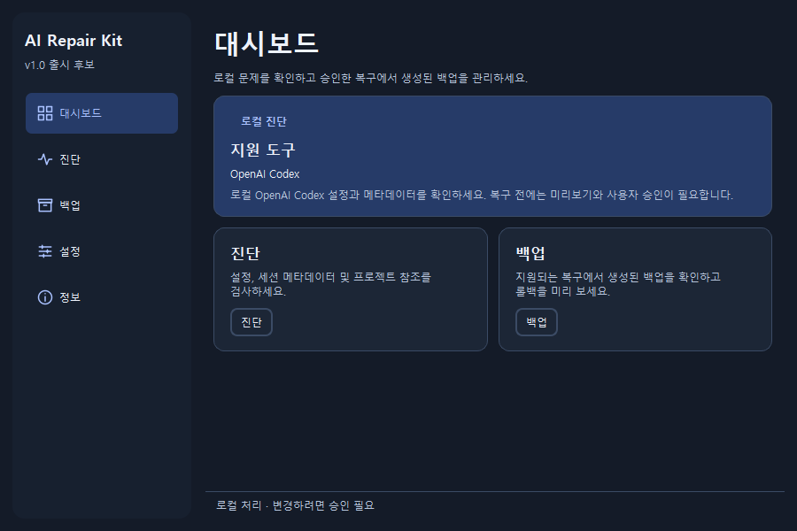

# AI Repair Kit 한국어 안내

AI Repair Kit은 Windows에서 Codex 프로젝트 목록, 채팅 연결, 세션 파일과 Goal 상태를 확인하는 로컬 도구입니다. 현재 버전은 첫 공개 릴리스를 준비 중인 **1.0.0rc2**입니다.

## 사용 방법

1. [README](../README.md#run-on-windows)의 PowerShell 명령으로 실행하세요. 로컬 빌드가 있다면 `AI-Repair-Kit.exe`와 `_internal` 폴더를 함께 두고 실행하세요.
2. **설정**에서 한국어와 라이트 또는 다크 테마를 선택할 수 있습니다.
3. **진단**에서 정확한 Codex 데이터 폴더를 지정하고 **진단 실행**을 누르세요. 진단은 로컬 메타데이터를 읽습니다.
4. 복구가 가능한 경우 변경 미리보기를 확인하세요. Codex와 관련 백그라운드 프로세스를 종료한 후 변경을 승인하면 프로그램이 백업을 검증하고 복구합니다.
5. 필요한 경우 **백업**에서 롤백을 미리보고 별도로 승인하세요. 복구한 파일이 그 뒤 변경되면 프로그램은 덮어쓰기를 거부합니다.

지원 범위는 Windows x64용 Codex MSIX 버전과 오류 조건에 따라 달라집니다. 설정 파일이 전부 NUL 바이트인 경우와 [정해진 Desktop 캐시 오류](desktop-recovery.md)만 복구할 수 있습니다. 세션 본문과 Goal은 진단 대상입니다. 유틸리티가 이 데이터를 다시 만들거나 수정하지 않습니다.

채팅이 열리지만 일부 기록이 보이지 않으면 **특정 스레드 또는 Goal 확인**으로 채팅과 세션 참조를 검사할 수 있습니다. 페이지 방식의 스레드는 알려진 기록 인덱스 파일의 존재 여부도 표시합니다. 이 확인은 대화 파일을 열지 않으며, 메시지 삭제나 화면 누락을 확정할 수 없습니다. [채팅 기록 진단 근거](desktop-recovery.md#a-chat-opens-with-only-part-of-its-history)

자동 테스트와 오프라인 VM 검증에는 합성 데이터를 사용했습니다. 실제 Codex Desktop 화면에 복구된 항목이 다시 표시되는지와는 별개의 결과입니다. [검증 기록](desktop-vm-verification.md)

일반 오류나 제안은 [GitHub Issues](https://github.com/CGI07/ai-repair-kit/issues)에 합성 재현 자료와 함께 올려 주세요. 사용자 데이터, 백업, 토큰, 원본 로그, 개인 경로가 보이는 화면은 공유하지 마세요. 보안 문제는 [비공개 신고 절차](../SECURITY.md)를 이용하세요.
